# Protótipo: Não Morda a Isca!

Jogo educativo para Android, offline, para crianças e adolescentes de 8 a 14 anos. Quem joga recebe o celular de uma personagem, a **Clara Azevedo**. Uma colega encaminha uma oferta de skin "grátis" pelo app de mensagens. Para decidir o que fazer, o jogador precisa juntar pistas em dois aplicativos, o **Send** (mensagens) e o **Navegador**. Depois de escolher, a **Capi**, guia do jogo, mostra a consequência e explica por que ela importa.

A ideia central: **nem toda oferta é golpe, e nem toda mensagem é confiável**. Não basta desconfiar de tudo. O jogador aprende a separar quem enviou a mensagem do que ela pede, e a confirmar a informação por um canal que já conhece.

As telas seguem o design do Figma *Não Morda a Isca*, que simula um sistema de celular com o tema "maré noturna". Os prints abaixo foram tirados no emulador do Android Studio (Pixel, API 37), percorrendo o fluxo completo. Eles estão em [`screenshots/`](../screenshots).

## Como rodar

```bash
./gradlew testDebugUnitTest
./gradlew installDebug
```

Use um emulador ou aparelho com Android 6.0 (API 23) ou mais recente. Detalhes de ambiente estão no [README](../README.md). Para tirar os prints de novo depois de mudar o visual:

```bash
bash scripts/capturar-prints.sh
```

O script precisa de um emulador ligado com o app instalado, do `adb` e de Python com Pillow. No Windows, rode com `ADB=... PYTHON=python`.

## Passo a passo

### 1. Início e faixa etária

No início, o jogador escolhe a faixa etária. A escolha muda os textos, as pistas e as alternativas da investigação:

- **Explorador (8–10):** situação direta e orientação mais explícita.
- **Agente (11–14):** mais contexto e sinais mais ambíguos.

| Início | Faixa Agente selecionada |
| :---: | :---: |
|  | 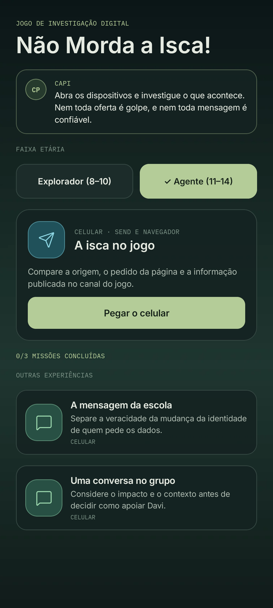 |

### 2. O celular da Clara

**Pegar o celular** abre a tela de bloqueio, já com a notificação da mensagem da Lia. Para desbloquear, arraste o ponto até o fim ou toque no cadeado. Tocar na notificação abre direto a conversa.

A tela inicial tem o objetivo da Capi no cartão de lembrete e os 11 aplicativos. O número sobre o **Send** mostra quantas pistas ainda não foram examinadas ali. Os outros apps (Galeria, Tmail, Social…) abrem, mas avisam que não há pistas deste caso neles. Eles existem para o celular parecer real.

| Bloqueio | Tela inicial | App sem pistas |
| :---: | :---: | :---: |
| 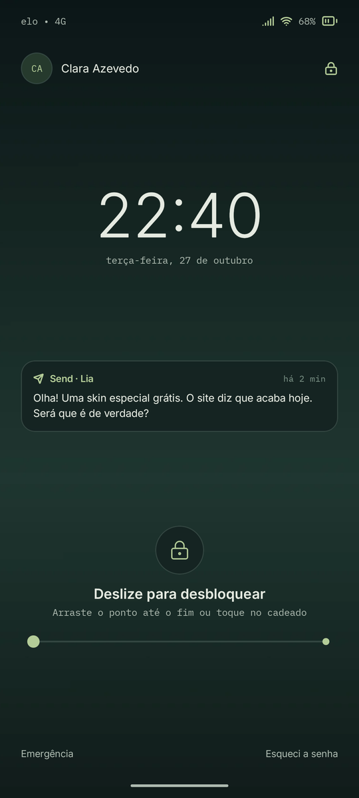 | 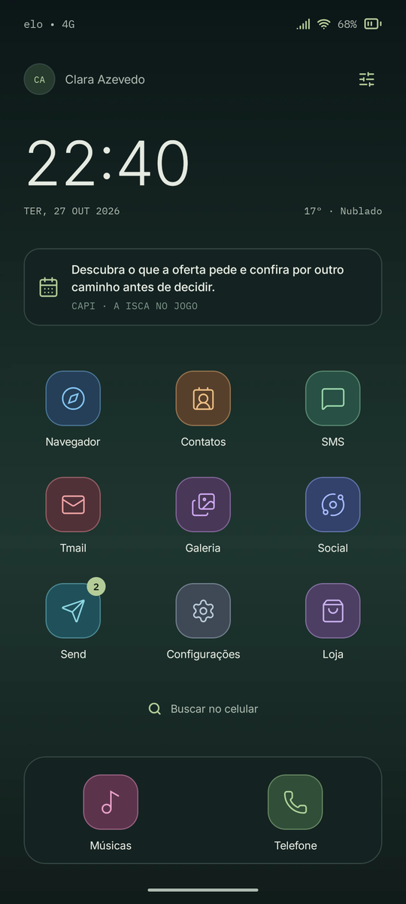 | 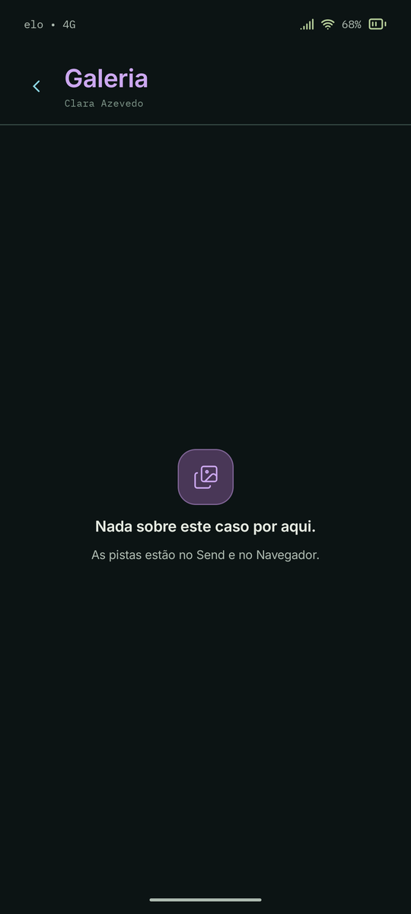 |

### 3. Investigar no Send

No Send fica a conversa com a Lia. A Capi resume a situação no alto da conversa, e as pistas aparecem como cartões. Cada pista passa por três estados:

1. **Disponível:** "selecione para examinar".
2. **Descoberta:** mostra o conteúdo e o botão **Anotar como pista**.
3. **Anotada:** marcada com ✓.

O campo de mensagem lembra o que falta para conseguir responder.

| Conversas | Conversa com a Lia | Pista examinada | Pista anotada |
| :---: | :---: | :---: | :---: |
| 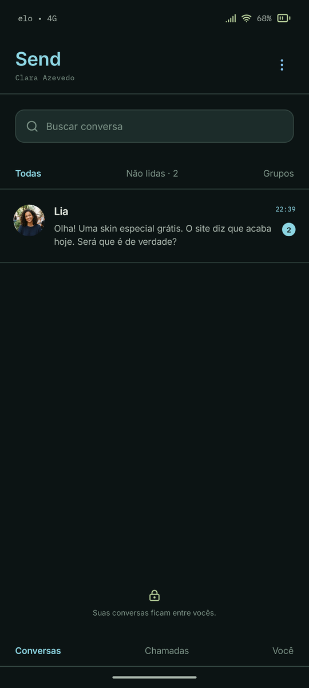 | 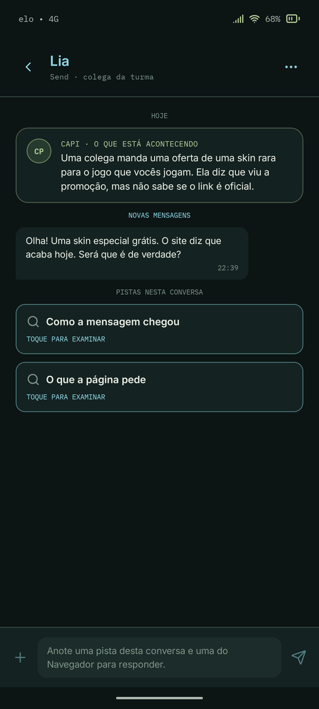 | 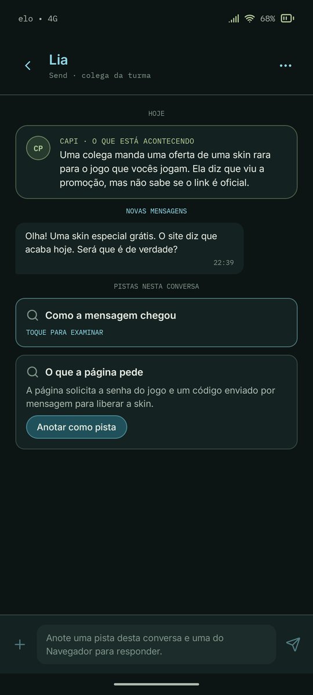 | 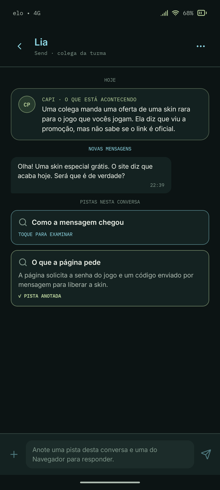 |

### 4. Conferir no Navegador

O Navegador abre pela tela inicial e mostra as pistas de verificação em **Para conferir**. Aqui o jogador encontra, por exemplo, a informação publicada pelo próprio jogo. O contador ("1 de 2 anotadas") mostra o progresso nesse app. A seta de voltar da barra inferior leva de volta à conversa.

| Navegador | Pista anotada no Navegador |
| :---: | :---: |
| 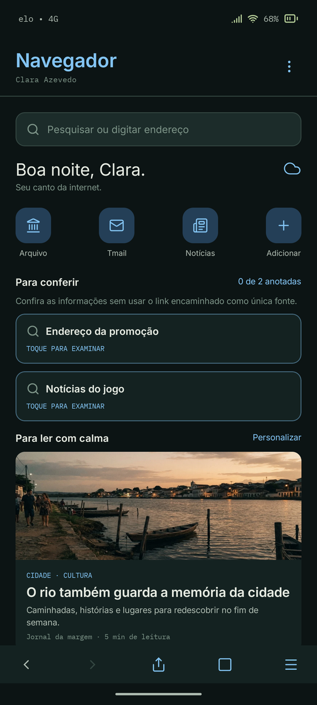 | 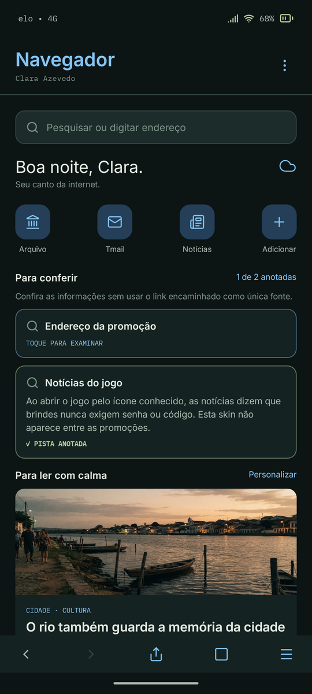 |

### 5. Decidir, ver a consequência e aprender

As alternativas só aparecem na conversa, como respostas, depois que as pistas necessárias foram anotadas. Na trilha Explorador, elas são o pedido da página (Send) e as notícias do jogo (Navegador). Quem controla essa liberação é o `InvestigationReducer`, não a tela.

O fluxo abaixo mostra a escolha de maior risco, digitar senha e código:

1. A Capi mostra a consequência e explica o motivo.
2. Uma tela de recuperação mostra o que fazer depois do erro.
3. A investigação termina com a conclusão do caso.

Em qualquer consequência dá para **voltar à conversa e reconsiderar**. As escolhas mais seguras vão direto para a conclusão.

| Escolhas liberadas | Consequência | Recuperação | Conclusão |
| :---: | :---: | :---: | :---: |
| 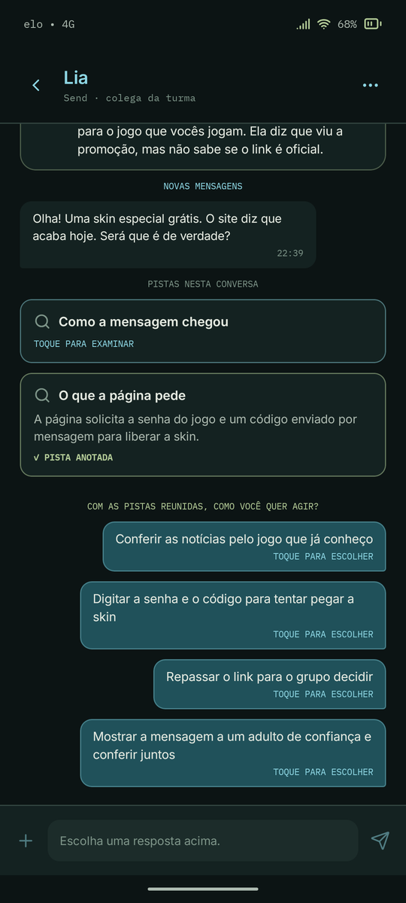 | 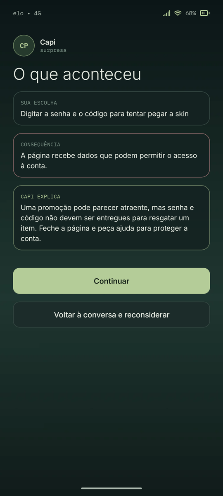 | 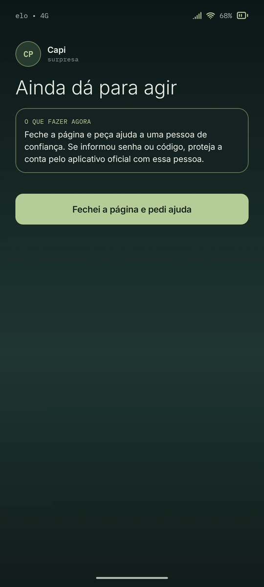 | 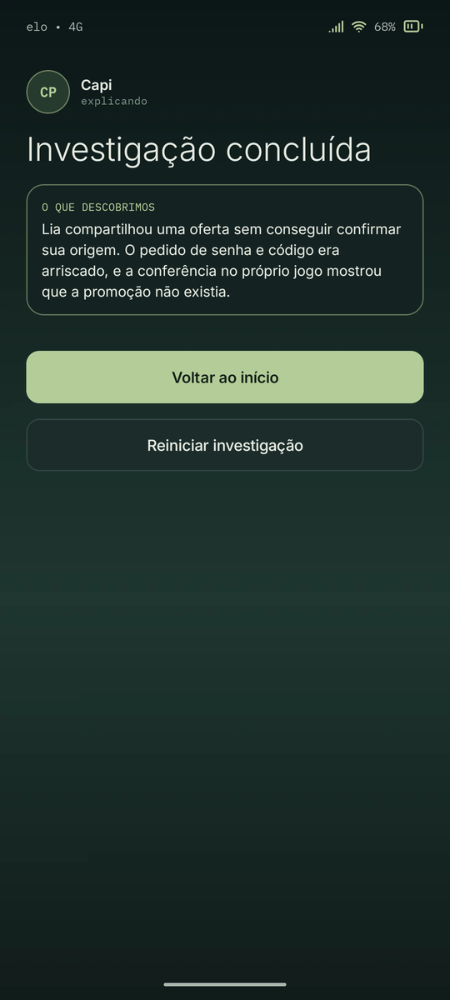 |

### 6. Reiniciar, sair e progresso

Reiniciar e sair sempre pedem confirmação. Cancelar mantém a tentativa como estava. Os apps e a tela inicial têm um menu "mais opções" com essas duas ações, e o botão voltar do Android também pede confirmação antes de sair.

O progresso fica salvo no aparelho, sem conta e sem internet. A missão concluída conta no placar do início.

| Confirmar reinício | Menu de opções | Confirmar saída | Início com progresso |
| :---: | :---: | :---: | :---: |
| 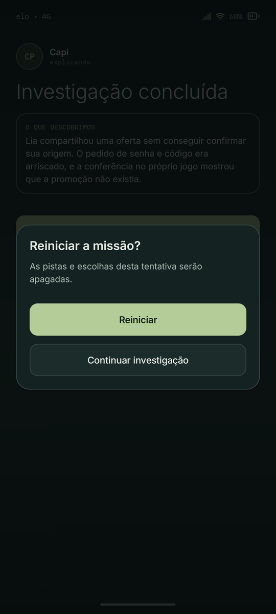 | 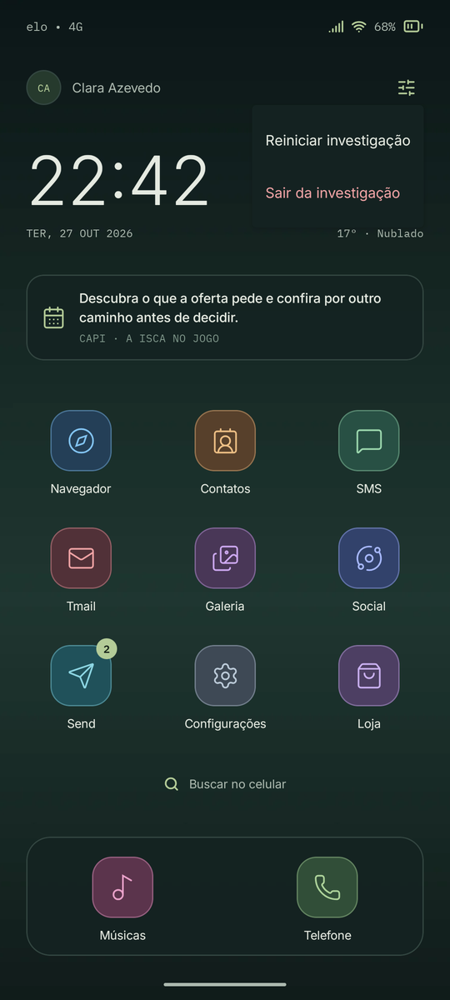 | 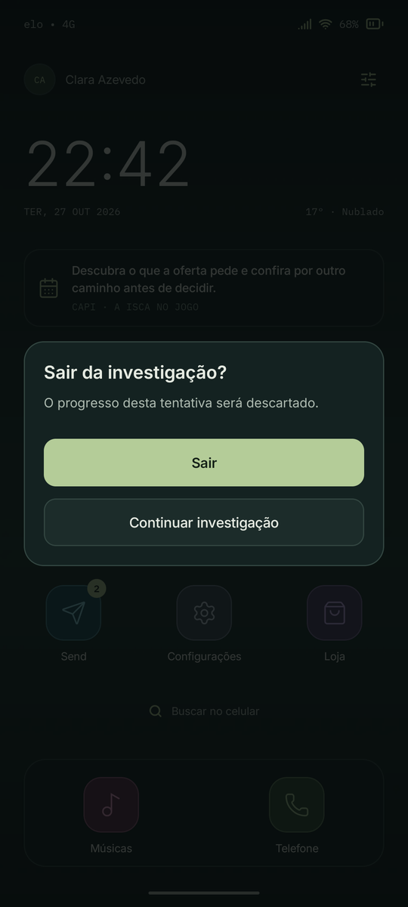 | 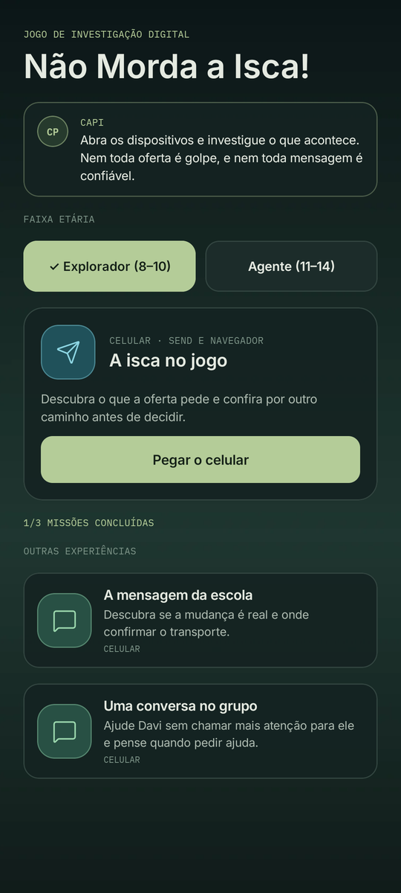 |

### 7. Outras experiências

As missões *A mensagem da escola* e *Uma conversa no grupo* ainda usam o fluxo por etapas anterior. Elas ganharam o mesmo visual (cabeçalho de app, cartões da Capi, detalhes examináveis e respostas como mensagens), mas ainda não passaram para o formato de investigação em vários apps.

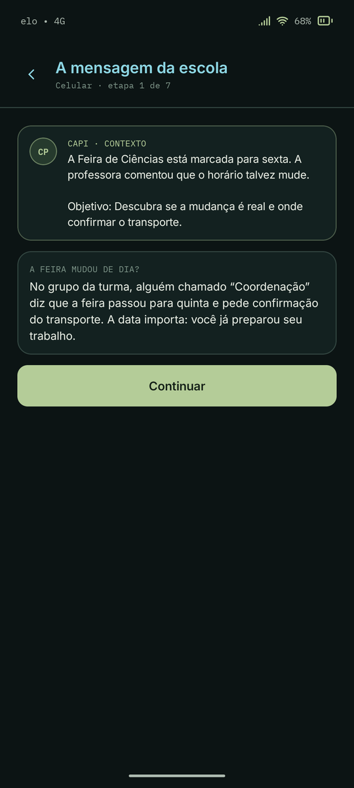

## Como está organizado

| Parte | Onde | O que faz |
| --- | --- | --- |
| Regras do jogo | `game/` | Modelos, catálogos de conteúdo e reducers puros (sem Android). Decidem pistas, liberação das escolhas, consequências e conclusão. Têm testes unitários. |
| Persistência | `data/` | Salva as missões concluídas e a tentativa ativa em SharedPreferences. |
| Tema | `ui/theme/` | Cores, fontes (Inter e IBM Plex Mono) e tipografia do Figma. |
| Componentes | `ui/kit/` | Moldura do celular (barra de estado, cabeçalhos, indicador de início), cartões, bolhas de mensagem, cartão de pista, botões e confirmação. |
| Investigação | `ui/investigation/` | Bloqueio, tela inicial, Send, Navegador, apps sem pistas e as telas da Capi (consequência, recuperação, conclusão). |
| Início e missões antigas | `ui/hub/`, `ui/legacy/` | Tela inicial do jogo e o fluxo por etapas. |

A tela não decide nada sobre o jogo. Ela mostra o estado e envia ações (`GameAction`) para o reducer. O que é só do celular simulado (bloqueado, tela inicial ou qual app está aberto) fica na interface. O progresso da investigação (pistas, escolhas, etapa) fica na sessão do reducer. É por isso que alternar entre Send e Navegador não perde nada.

Os ícones (vetores), o papel de parede e as fotos foram exportados do Figma para `res/drawable` e `res/drawable-nodpi`. As fontes estão em `res/font` e têm licença livre (OFL).

## Limitações conhecidas

- **Só celular:** as telas de computador do Figma ainda não foram implementadas.
- **Apps extras vazios:** Tmail, Galeria, Social, Loja e os outros não têm conteúdo próprio.
- **Sem tela de senha:** o desbloqueio vai direto para a tela inicial, sem a tela de senha do Figma, para não travar o jogo.
- **História diferente do Figma:** o caso é o da Lia e da oferta de skin. A história do Figma (Mauro, chave do arquivo municipal, gravação) ainda não virou missão. Na tela, a contato aparece como "Lia", nome vindo do texto da missão.
- **Sem teste em TV Box:** não foi testado em TV Box nem com controle remoto. O app trocou o Material para TV pelo Material 3, e os botões ainda não têm destaque visual de foco.
- **Sem testes de tela automatizados:** não há testes instrumentados. A validação visual foi feita no emulador, com os prints acima.
- **Barras do Android escondidas:** elas ficam ocultas para o celular simulado ocupar a tela. Na primeira abertura, o Android mostra um aviso de "tela cheia".

## Próximos passos sugeridos

1. Transformar a história do Figma (Clara, Mauro e o arquivo municipal) em uma nova investigação, usando Tmail, Galeria e Social.
2. Migrar as duas missões antigas para o formato de investigação em vários apps.
3. Implementar as telas de computador para demonstrações em tela grande.
4. Revisar o conteúdo com educadores e testar com crianças das duas faixas etárias.
